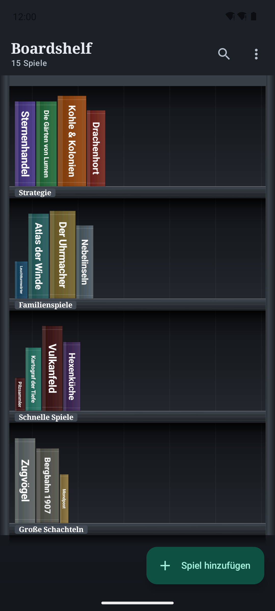
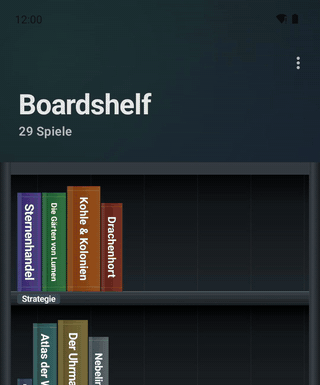
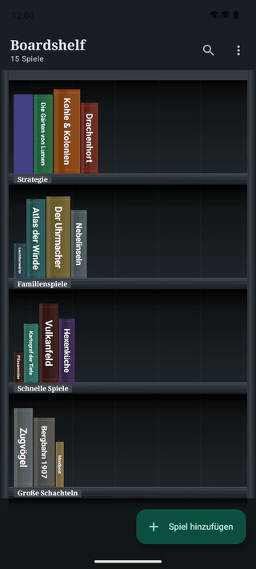
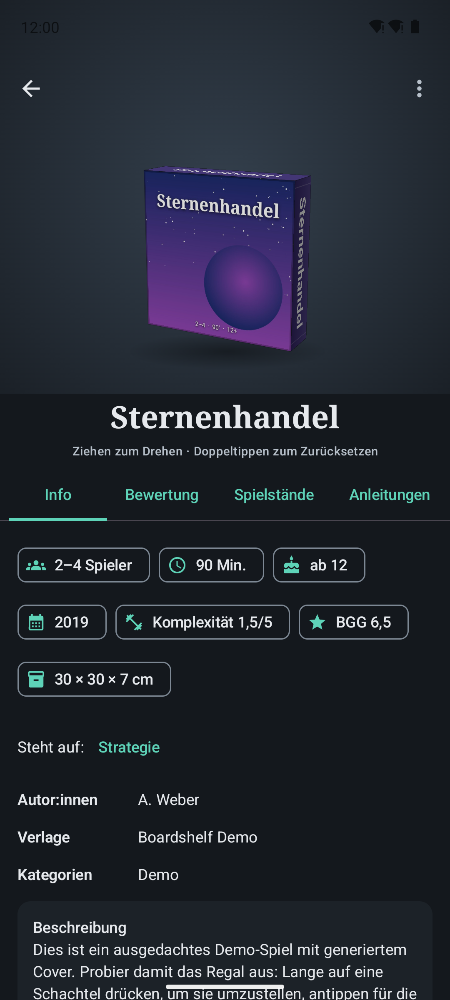
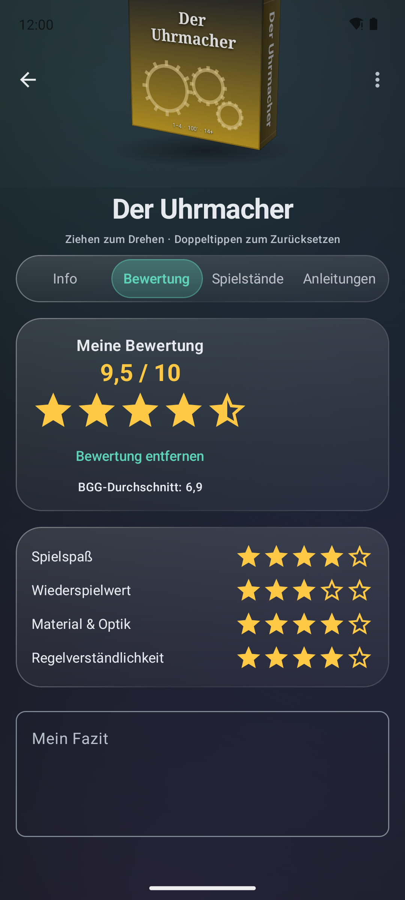
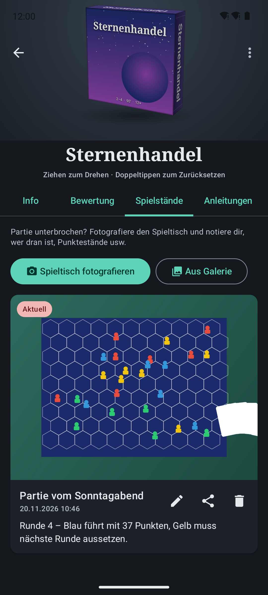
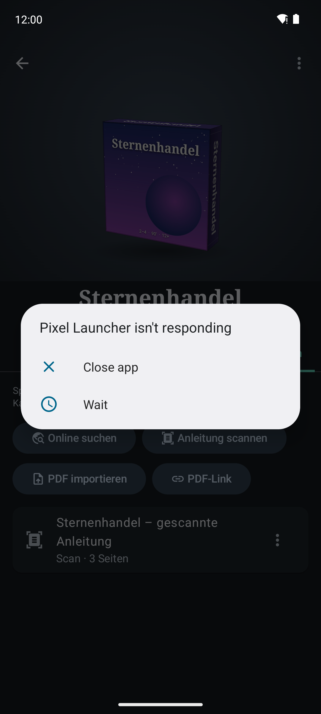

# Boardshelf

**Deine Brettspielsammlung als Regal – auf dem Android-Handy.**
*Your board game collection as a shelf – on your Android phone.* ([English below](#english))

<p align="center">
  
  
  
  
</p>
<p align="center">
  
  
  
</p>

## Funktionen

- **Regalansicht** – die Schachteln stehen mit dem Rücken nach vorn auf Regalböden, in echter Größe zueinander (Maße von BoardGameGeek, anpassbar).
- **Durchblättern** – lange auf das Regal drücken und über die Schachteln streichen: Die Schachtel unter dem Finger kommt heraus und zeigt ihr Cover, die vorige gleitet zurück.
- **Umsortieren** – im Modus „Regal umsortieren“ (Menü) Schachteln lange drücken und auf einen anderen Platz oder Regalboden ziehen. Regalböden lassen sich anlegen, umbenennen, verschieben und löschen.
- **Herausziehen in 3D** – Antippen zieht die Schachtel aus dem Regal, dreht sie und öffnet die Detailseite. Dort lässt sie sich mit dem Finger frei drehen (Doppeltippen setzt zurück).
- **Barcode-Scanner** – Barcode auf der Schachtel scannen, das Spiel wird mit Cover angelegt (GameUPC inkl. europäischer Ausgaben, UPCitemdb, Open Products Facts, Wikidata).
- **KI-Bilderkennung (optional)** – Claude, Gemini, ChatGPT oder ein selbst gehostetes Modell (Ollama, LM Studio …) wählt und schneidet Cover automatisch und erkennt Spiele auf einem Foto der Schachtel.
- **Spieldaten** ohne Anmeldung aus **Wikidata/Wikipedia**, optional zusätzlich von **BoardGameGeek** (Spieler, Dauer, Alter, Autor:innen, Verlage, Mechaniken, BGG-Wertung, Rang, Schachtelgröße) sowie **Wikidata/Wikipedia** .
- **BGG-Sammlung importieren** – Benutzername eintragen, alle eigenen Spiele inkl. deiner BGG-Wertung landen im Regal.
- **Bewerten** – Gesamtnote (0,5er-Schritte bis 10), Spielspaß, Wiederspielwert, Material & Optik, Regelverständlichkeit und ein Fazit.
- **Spielstände** – Spieltisch fotografieren, mehrere Fotos pro Spielstand (Kamera oder Galerie), Titel und Notiz dazu („Blau ist dran, 37 Punkte …“). Der neueste Stand ist markiert, Fotos lassen sich zoomen und teilen.
- **Anleitungen** – PDF importieren, per Link laden, im eingebauten Browser suchen (BGG-Dateibereich, DuckDuckGo, Google, 1j1ju – jedes geöffnete PDF kann gespeichert werden) oder die gedruckte Anleitung **mit der Kamera scannen**. Alles offline lesbar, mit Zoom; Scans lassen sich als PDF teilen.
- **Cover-Suche** – auch ohne BGG-Token: in Bildersuche, Amazon oder auf der BGG-Website lange auf das richtige Schachtelbild drücken und übernehmen. Danach lässt sich das Bild **zuschneiden** (Schachtelformat, quadratisch oder frei, drehbar), das geht auch bei Kamerafotos und vorhandenen Covern. Automatisch wird nichts geraten; Wiki-Bilder werden nur genutzt, wenn sie eindeutig die Schachtel zeigen.
- **Eigenes Cover** fotografieren, Daten von Hand bearbeiten, Spiele ohne Online-Eintrag manuell anlegen.
- **Datensicherung** als ZIP (Datenbank, Cover, Fotos, Anleitungen) und Wiederherstellung.
- **Deutsch und Englisch**, umschaltbar in den Einstellungen (oder Systemsprache).
- **Demo-Sammlung** mit ausgedachten Spielen zum Ausprobieren.

## Installation

APK aus dem [neuesten Release](https://github.com/Schnubbirunkel/Boardshelf/releases/latest) herunterladen und installieren (Android 8.0 oder neuer, „Installation aus unbekannten Quellen“ erlauben).

## Datenquellen & KI

- Ohne jede Anmeldung: Wikidata/Wikipedia (Spieldaten), GameUPC-Testzugang, UPCitemdb und Open Products Facts (Barcodes & Cover).
- GameUPC hat keine Anmeldung; genutzt wird der öffentliche Zugang (wie in den GameUPC-Beispielprogrammen). Ausgewählte Barcode-Zuordnungen werden an GameUPC zurückgemeldet.
- Optional: BoardGameGeek-Token, KI-Anbieter mit eigenem API-Schlüssel oder ein selbst gehostetes OpenAI-kompatibles Modell (z. B. Ollama mit `qwen2.5vl`). Alles unter **Einstellungen**.

## Bauen

```bash
./gradlew assembleDebug        # app/build/outputs/apk/debug/
./gradlew assembleRelease      # signiert mit dem Schlüssel aus den Umgebungsvariablen (siehe unten)
```

GitHub Actions baut bei jedem Push die APKs. Steht in `VERSION` eine neue Versionsnummer, wird automatisch ein Release mit APK und Screenshots veröffentlicht.
Die APKs werden mit dem Projektschlüssel aus `keystore/` signiert, damit gehen Updates direkt über die installierte Version. Optional lässt sich ein eigener geheimer Schlüssel per Secrets hinterlegen: [docs/SIGNING.md](docs/SIGNING.md).

Technik: Kotlin, Jetpack Compose, Room, OkHttp, Coil. Die 3D-Schachtel ist ein eigener kleiner Software-Renderer (perspektivische Texturabbildung per `Matrix.setPolyToPoly`), ganz ohne OpenGL.

---

## English

Boardshelf shows your board game collection as a shelf. Boxes stand with their spines facing out, true to scale. Long-press and slide over the shelf to pull out the boxes and see their covers; rearrange them in the “Rearrange shelf” mode. Tap a box to watch it get pulled out of the shelf in 3D, turn around and become the detail page, where you can spin it freely.

- **Barcode scanner**: scan the box, the game is added with its cover (GameUPC, UPCitemdb, Open Products Facts, Wikidata).
- Game data from **Wikidata/Wikipedia** without any sign-up, optionally **BoardGameGeek**.
- Optional **vision AI** (Claude, Gemini, ChatGPT or self-hosted via Ollama/LM Studio) picks and crops covers and recognises games on a photo of the box.
- **Import your BGG collection** including your own ratings.
- **Ratings**: overall score plus fun, replayability, components and rules clarity, and a written review.
- **Game states**: photograph the table to save a running game, with title and note.
- **Rulebooks**: import PDFs, download by link, find them with the built-in browser (BGG files, web search) or **scan the printed rulebook** with the camera. Everything works offline.
- **Cover search** without a BGG token: long-press the right box picture in image search, Amazon or on the BGG website, then **crop** it (box format, square or free).
- Own cover photos, manual editing, ZIP backup and restore, demo collection.
- UI in **English and German**, switchable in the settings.

Download the APK from the [latest release](https://github.com/Schnubbirunkel/Boardshelf/releases/latest).

<sub>Powered by BoardGameGeek. Game data © BoardGameGeek and Wikidata/Wikipedia contributors. The demo games are fictional.</sub>
