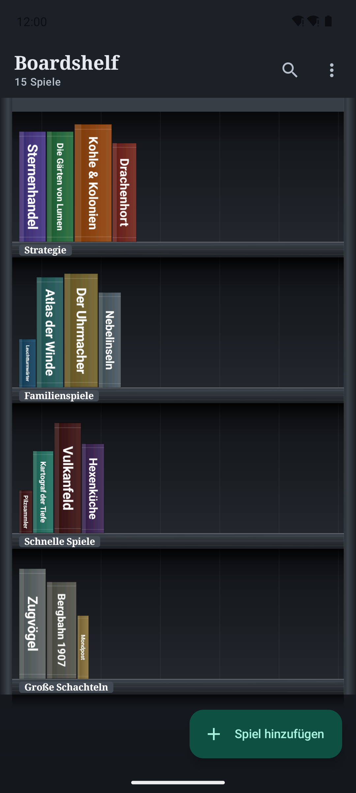
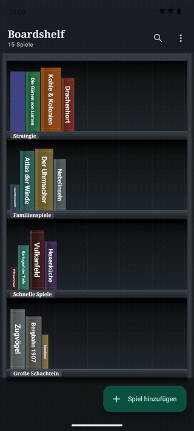
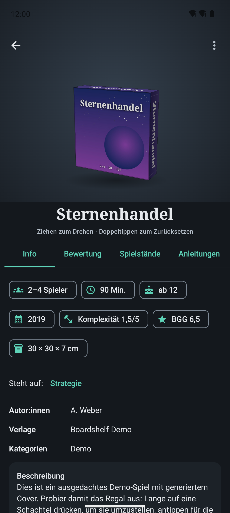
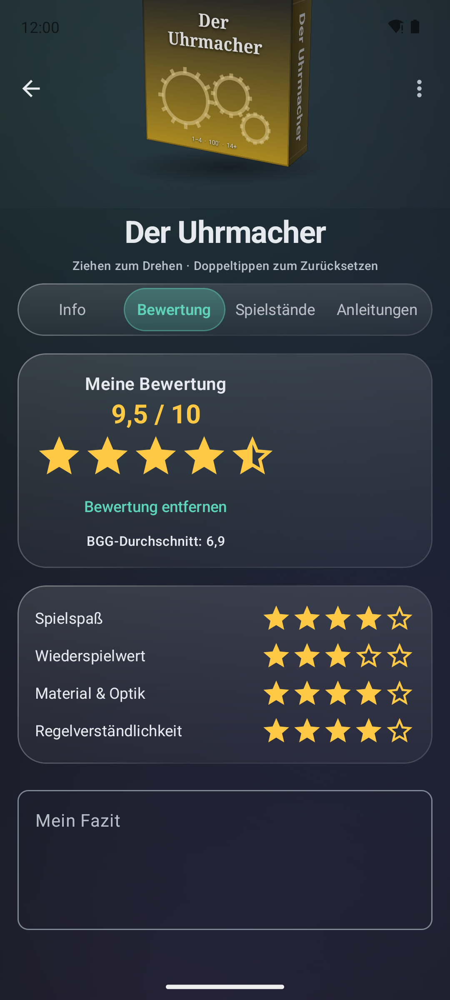
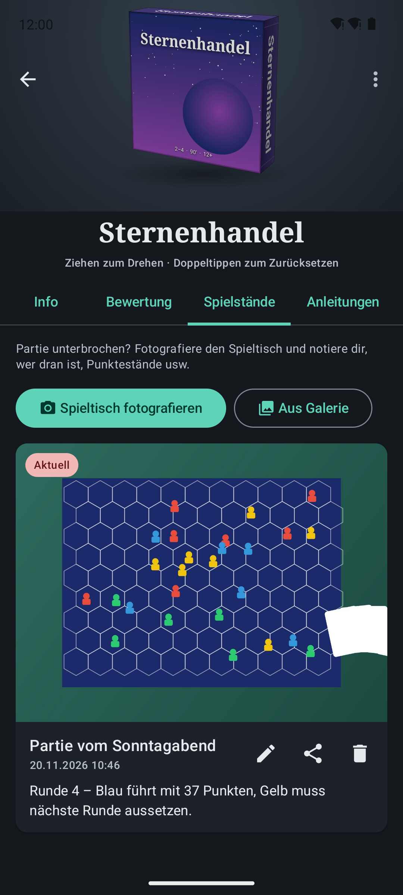
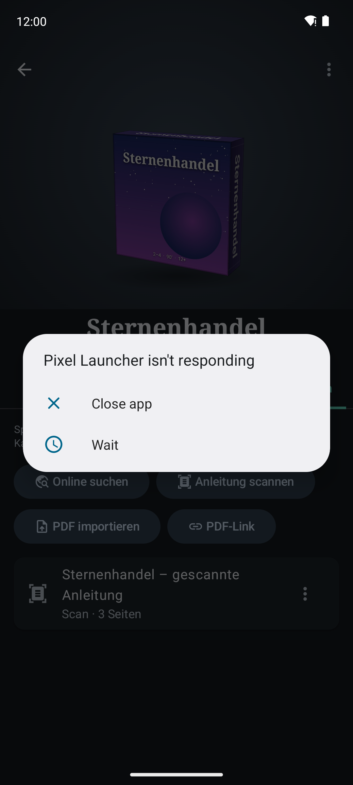

Erste Version von **Boardshelf** – deine Brettspielsammlung als Regal.

### Neu
- Dunkles Regal, Schachteln stehen gerade mit dem Rücken nach vorn, maßstabsgetreu
- Umsortieren per Lange-Drücken-und-Ziehen, Regalböden verwalten
- Antippen: Schachtel wird in 3D aus dem Regal gezogen und geht in die Detailansicht über, dort frei drehbar
- Daten von BoardGameGeek (API-Token nötig) und Wikidata/Wikipedia, Import der BGG-Sammlung
- Bewertung (Gesamtnote + 4 Kategorien + Fazit)
- Spielstände als Foto vom Spieltisch mit Notiz
- Anleitungen: PDF importieren, per Link oder im eingebauten Browser laden, gedruckte Anleitung mit der Kamera scannen
- Datensicherung als ZIP, Oberfläche Deutsch/Englisch, Demo-Sammlung

### Installation
`Boardshelf-1.0.0.apk` herunterladen und installieren (Android 8+). BGG-Token unter Einstellungen → BoardGameGeek eintragen.
