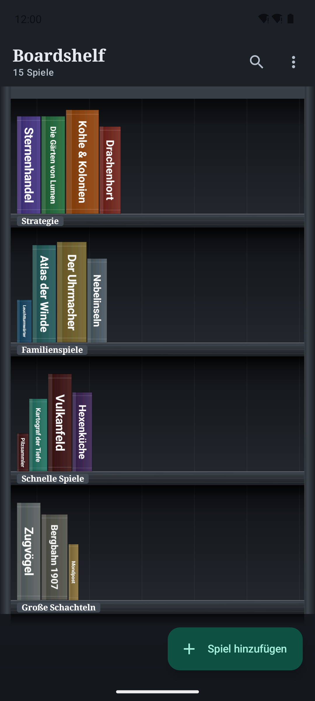
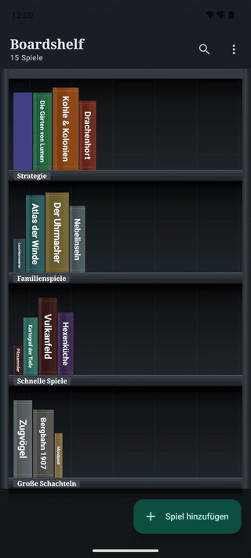
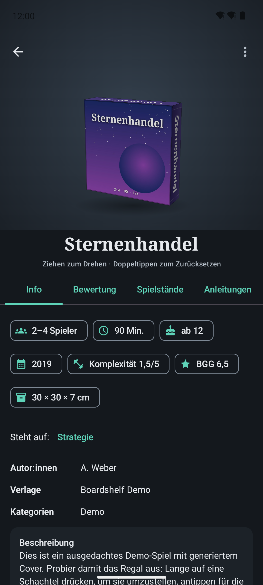

**Boardshelf 1.1.0** – Cover-Suche

### Neu
- **Cover im Web suchen** (auch ohne BGG-Token): Bildersuche, Google, Amazon oder BGG-Website öffnen, lange auf das richtige Schachtelbild drücken, Vorschau prüfen, übernehmen. Zu kleine Vorschaubilder werden abgelehnt.
- Hinweis mit Buttons auf dem Info-Tab, wenn ein Spiel noch kein Cover hat.

### Verbessert
- Bilder aus Wikidata/Wikipedia werden nur noch als Cover genutzt, wenn sie eindeutig die Schachtel zeigen. Fotos vom Spieltisch (z. B. bei „Nemesis“) werden nicht mehr übernommen.

### Installation
`Boardshelf-1.1.0.apk` herunterladen und installieren (Android 8+).
