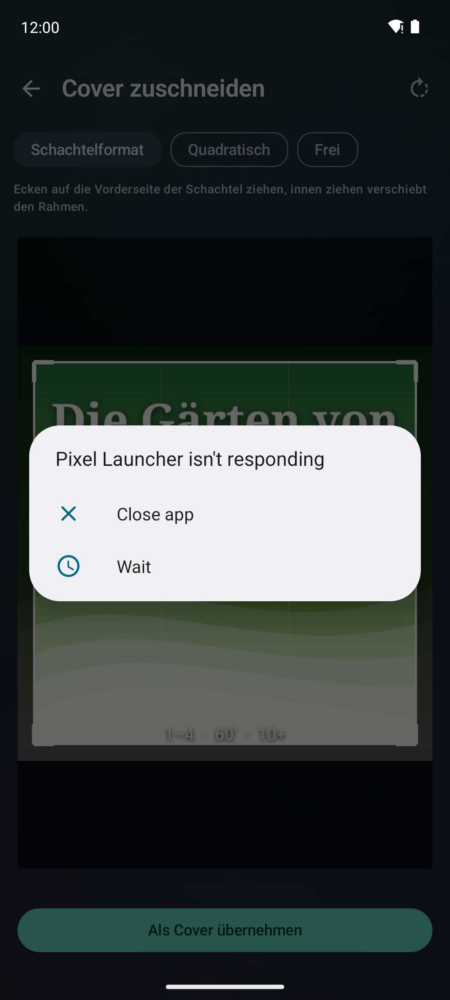
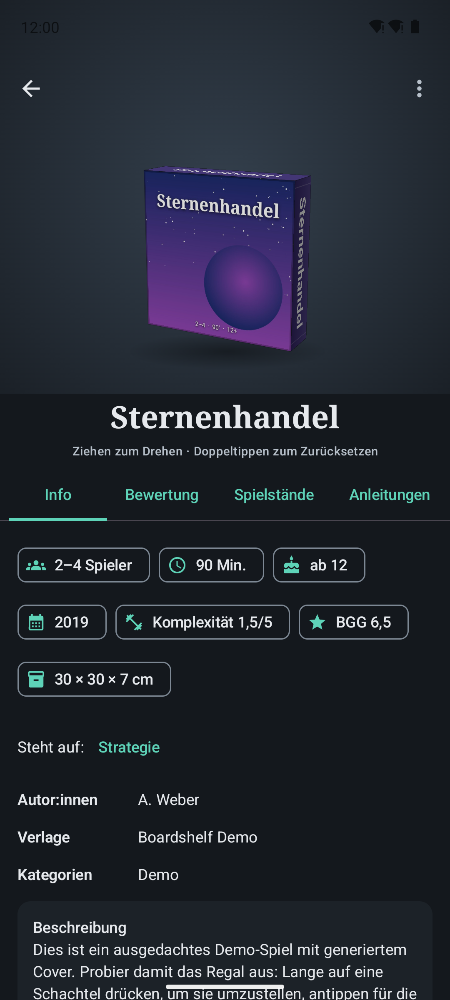

**Boardshelf 1.2.0** – Cover zuschneiden

### Neu
- **Cover zuschneiden**: Nach jeder Cover-Auswahl (Web-Suche, Kamera, Galerie) öffnet sich der Zuschnitt. Vorhandene Cover lassen sich über das Menü „Cover zuschneiden“ nachbearbeiten.
- Rahmen im **Schachtelformat** (passend zu den Maßen der Schachtel), **quadratisch** oder **frei**; Ecken ziehen ändert die Größe, innen ziehen verschiebt.
- Bild um 90° drehen.

### Installation
`Boardshelf-1.2.0.apk` herunterladen und installieren (Android 8+).
