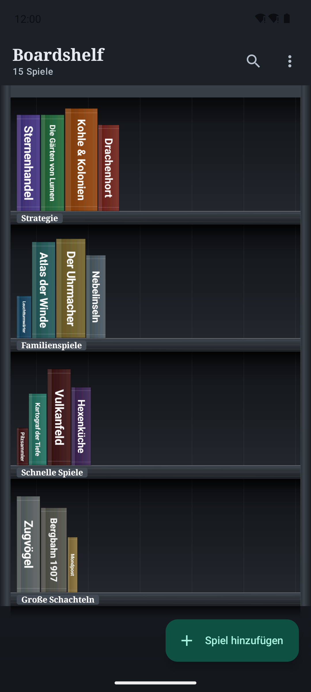
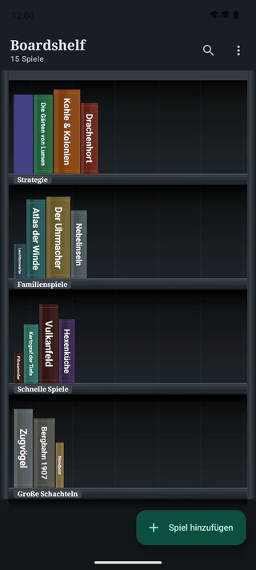
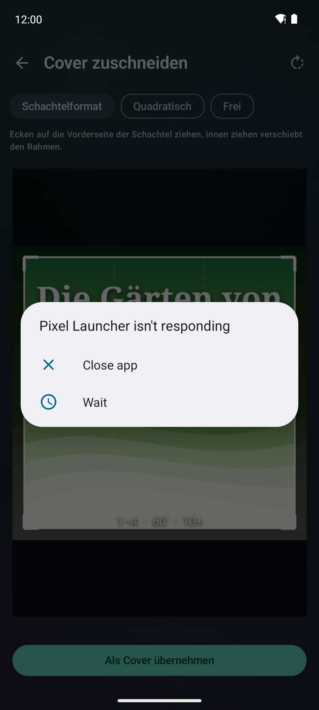

**Boardshelf 1.2.1** – feste Signatur

- Alle APKs werden ab jetzt mit demselben Projektschlüssel signiert. **Updates lassen sich ab dieser Version direkt über die installierte App installieren.**
- Einmalig beim Wechsel von 1.0.0–1.2.0: In der App unter Einstellungen → Datensicherung exportieren, alte App deinstallieren, 1.2.1 installieren, Sicherung wiederherstellen.

