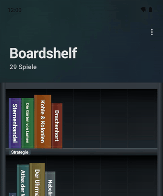

**Boardshelf 1.7.0** – Durchs Regal blättern

- **Lange drücken und über die Schachteln streichen**: Die Schachtel unter dem Finger gleitet aus dem Regal und dreht sich, sodass das Cover zu sehen ist, mit Titel und Jahr darunter. Streichst du weiter, kommt die nächste heraus und die vorige verschwindet wieder ins Regal. Loslassen stellt alles zurück.
- **Umsortieren** hat jetzt einen eigenen Modus: Menü → „Regal umsortieren“, dann Schachteln lange drücken und ziehen, „Fertig“ beendet den Modus.
- Antippen öffnet wie bisher die Detailseite mit der 3D-Animation.
